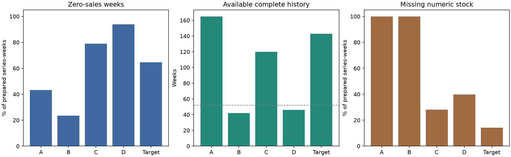

# Data evaluation — 2026-11-21

The local data are sufficient to proceed to validation design and a controlled
model comparison. They do not justify selecting a winning model or assuming
pooled training will help. No replacement datasets or GPU are needed for this stage.

## Scope and reproduction

One agent; Senior Data Scientist skill consulted. Raw and existing prepared data
were read only. Existing D26 metric and preparation rules were inspected, not
changed or certified as the organizers' exact implementation.

Commands from repository root:

```bash
.venv/bin/python iterations/05-data-evaluation/audit.py
.venv/bin/python iterations/05-data-evaluation/supplement.py
.venv/bin/python tests/test_validate.py
```

The first command refuses to overwrite its output directory. For another audit:
`audit.py --output /tmp/lemebase-data-audit-rerun` (choose a fresh directory).
The supplement reads the canonical `results/` directory.

Python 3.12.4, pandas 2.3.3, numpy 2.5.5, pyarrow 26.0.1. Exact input hashes,
script hash, and starting Git revision are in [metadata.json](results/metadata.json).
Saved prediction hashes are in [supplemental_checks.json](results/supplemental_checks.json).
The current Python differs from the old README's Python 3.13 instructions.

## Data inventory and integrity

Series means store × article, not necessarily a unique product across stores.
Zero percentages below use the existing prepared grids, from each series' start.

| Dataset | Unique articles | Series | Complete weeks | Zero-sales weeks | Missing numeric stock |
|---|---:|---:|---:|---:|---:|
| A | 297 | 599 | 165 | 43.2% | 100% |
| B | 1,500 | 7,500 | 42 | 23.5% | 100% |
| C | 338 | 851 | 120 | 79.0% | 28.2% |
| D | 2,326 | 50,443 | 46 | 93.9% | 39.7% |
| Target | 2,904 | 2,904 | 143 | 64.7% | 14.2% |

Sources: [shop_summary.csv](results/shop_summary.csv),
[raw_files.csv](results/raw_files.csv), [raw_columns.csv](results/raw_columns.csv).



- All five prepared tables have unique store/article/week keys, Monday dates,
  contiguous per-series grids through the final week, no missing identifiers or
  units, finite nonnegative sales/known stock, and consistent stock-missing flags.
- A weekly rows, B transaction/line keys, C store/article/day keys, and target
  article/week keys contain no duplicates. D contains sales lines; repeated
  store/article/day keys are not automatically duplicate records and were not
  treated as such. This audit does not certify every side-table join.
- Independently regrouping raw sales reproduces every prepared weekly sales
  value under the current rules (maximum absolute discrepancy 0).
- B drops 18,658 boundary rows; C drops 855; D drops 1,176. Complete-week ranges
  are recorded in the summary. No preparation rerun overwrote existing tables.
- C has 326 negative-net series-weeks clipped to zero, adding 351 units; D has
  3,491, adding 3,512 units. This verifies existing behavior, not that clipping is
  uniquely correct. Returns must remain an explicit data-interpretation decision.
- D has 6,687 prepared stock observations flagged as originally negative;
  the target has 7. Stock clipping is likewise an existing convention.
- All raw and prepared file hashes were unchanged at the audit's end.

Source: [sales_reconciliation.csv](results/sales_reconciliation.csv).

## Sales patterns and information availability

- B is synthetic per the dataset card. Its last-13-week total is essentially
  unchanged versus the previous 13 weeks (-0.03%); D is much sparser. D alone
  contributes 50,443 of 59,393 A-D series (84.9%). Naive pooling can be dominated
  by one retail regime; these facts do not prove balanced pooling will improve it.
- Target median product averages 0.64 units/week, while the mean across products
  is 10.32: volume is highly uneven. 1,073 products have no sales in the final
  8 known weeks; 918 have none in the final 13.
- Target last-13-week sales are 6.3% below the preceding 13 weeks. This is a
  descriptive window comparison, not proof the trend continues into the future.
- C has 485 store/article series whose raw records stop before the dataset ends;
  445 have no prepared sales in the last 13 weeks. Zero-filled absence can mix
  genuine inactivity, discontinuation, and missing reporting. We cannot identify
  which explanation holds from a filled grid alone.
- A's aggregate lag-52 correlation is 0.756; target's is 0.431 (lag 50: 0.480).
  C's is 0.683 but trends/series exits can confound it. These descriptive total
  correlations do not establish product-level seasonality. B and D cannot support
  an annual-lag comparison. Target calendar dates are shifted per the dataset card;
  cross-shop holiday alignment is not established.
- Numeric stock is unavailable in the prepared A/B histories. B's 1,576 STOCKOUT
  events all occur on 2025-01-01, in the discarded initial partial week; its
  prepared stockout flag is consequently constant false. That is an uninformative
  feature, not evidence B never stocks out.
- Target stock missingness falls from 40.9% in the first 13 weeks to 1.1% in the
  last 13. Mean recorded stock per known row falls from 537 in 2020 to 45 in 2023.
  C/D missingness instead rises to 52.1%/60.5% in the last 13 weeks. Stock quality
  and missingness vary across shops and time.
- Target weeks with recorded end stock zero average 1.04 sales, versus 15.80 with
  positive stock. This is contemporaneous association, confounded by product size
  and inventory mechanics; it is not a causal effect or a verified future predictor.
  Only past stock can enter a future forecast; future stock is unknown.
- Target inputs remain article ID, week, sales, and stock. Richer A-D fields cannot
  simply become required target-shop features. IDs do not match across datasets.

Sources: `series_*.csv`, `weekly_totals_*.csv`,
[aggregate_lag_correlations.csv](results/aggregate_lag_correlations.csv),
[test_stock_by_year.csv](results/test_stock_by_year.csv), and supplemental checks.

## Validation feasibility and metric coverage

Proposal evaluated: four nonoverlapping 13-week targets counted back from the
last complete week, each requiring at least 13 weeks of input history. This is
a feasibility assessment, not adoption of a new validation protocol.

| Dataset | Feasible contexts among four cuts | Own-shop origins at newest cut | At second cut |
|---|---:|---:|---:|
| A | 4 | 64 | 57 |
| B | 2 | 2 | 0 |
| C | 4 | 41 | 35 |
| D | 2 | 4 | 0 |
| Target | 4 | 53 | 46 |

Origins use the current 13-week minimum history, 13-week training targets, and
2-week spacing. Many products per origin do not create additional independent
time regimes. B/D's second cuts can score simple/pretrained/transferred models,
but cannot train the current own-shop window model. No annual seasonality can
be learned from B/D alone. Consider fewer comparable cuts or additional shifted
cuts, reporting their overlap rather than treating them as independent evidence.

On D's newest cut, 10,460/50,443 series have zero scale and are excluded by the
current metric. Of them, 9,613 sell during holdout and account for **46.8%** of
holdout units. Only **53.2%** of D holdout units are scored. At the second cut,
scored-unit coverage drops to **43.5%**. Always show exclusions and coverage;
an impressive D score does not prove good cold-start forecasts.

The target's newest cut scores 2,839/2,904 products, covering 99.1% of holdout
units. Excluded products still require predictions in the real submission.

The D series universe is based on having a raw sale somewhere in the full file,
including after historical cuts, and excludes 13,109 stock-only series. Historical
splits also enumerate future-known series. This does not leak their future sales
into lag features, but limits claims of realistic new-product discovery. A proper
deployment simulation needs an explicit product-universe availability rule.

Source: [validation_feasibility.csv](results/validation_feasibility.csv).

## Existing prediction errors

Saved LightGBM forecasts were re-scored against current local targets; no model
was retrained. Their provenance is historical, so this is score reproduction,
not proof that the current training environment regenerates identical forecasts.

| Target cut | LightGBM score | Median13 score | LightGBM gain |
|---|---:|---:|---:|
| Newest (2023-01-23) | -4.83 | -6.68 | +1.85 |
| 2022-10-24 | -28.45 | -30.53 | +2.08 |
| 2022-07-25 | -13.35 | -12.59 | -0.76 |
| 2022-04-25 | -15.44 | -16.34 | +0.90 |
| Equal-cut average | **-15.52** | **-16.54** | **+1.02** |

- Products with sales in the preceding 13 weeks contribute 90.2–91.9% of total
  scaled LightGBM error across these cuts. Inactive products have nonzero error,
  but are not the dominant improvement opportunity.
- The worst approximately 10% of scored products account for 58.7–64.1% of scaled
  error. They are identified after outcomes are observed; do not hard-code these
  identities as predictive rules. Investigate history-only characteristics.
- Among products with at least 75% zero weeks in their preceding 13-week history,
  LightGBM loses 1.10 points to median13 on the newest cut; the other cuts show
  much smaller differences. A sparsity-aware correction is a hypothesis, not yet
  a supported routing rule.
- On newest C/D cuts, zero forecasts score 58.76/69.13, versus median13's
  57.27/68.81. Zero also wins their other feasible cuts. This reflects sparsity,
  absolute-error incentives, and exclusions, not suitability for the target shop.
- Across shops, compare each model against baselines on the same shop/cut.
  Absolute scores across different shops do not rank model quality fairly.

Sources: [saved_lgbm_error_groups.csv](results/saved_lgbm_error_groups.csv),
[saved_lgbm_error_horizons.csv](results/saved_lgbm_error_horizons.csv),
[saved_lgbm_per_series.csv](results/saved_lgbm_per_series.csv).

## Recommendations and next checkpoint

1. Agree on validation before training: feasible temporal cuts, equal shop weighting,
   D coverage, product-universe rules, and leave-one-shop-out selection. Previously
   examined target cuts are development evidence, not untouched confirmation.
2. Preserve current preprocessing as the reference; test changes separately.
   Retain missing-stock indicators and avoid treating unavailable stock as zero.
3. Prioritize active-product error and recency/level correction. Compare robust
   medians, residual boosting, an alternative tree, and a bounded neural challenger
   on identical tasks before extensive tuning.
4. Test balanced and similarity-based pooling as hypotheses; do not assume pooling
   or a specific model family is the answer. No transfer benefit is proved here.
5. Confirm organizer handling of zero-scale histories and final/public horizons
   from an official specification. Existing local tests and baseline agreement
   validate implementation consistency, not official equivalence.

User action: no data upload or setup needed. If the friend has newer code/results
not present locally, supply the commit/branch or results before choosing experiments.
An accessible official metric specification would resolve the remaining scoring
ambiguity. Review the validation recommendations before the next stage begins.

Checks completed: all audit assertions passed, existing metric tests passed, stored
baseline scores matched where available, and the comparison plot was visually
inspected. NumPy timedelta deprecation warnings and font-cache warnings occurred;
the commands completed successfully. Forecast pipelines, existing artifacts, and
raw data were not modified. No agents launched, training run, or submission made.
