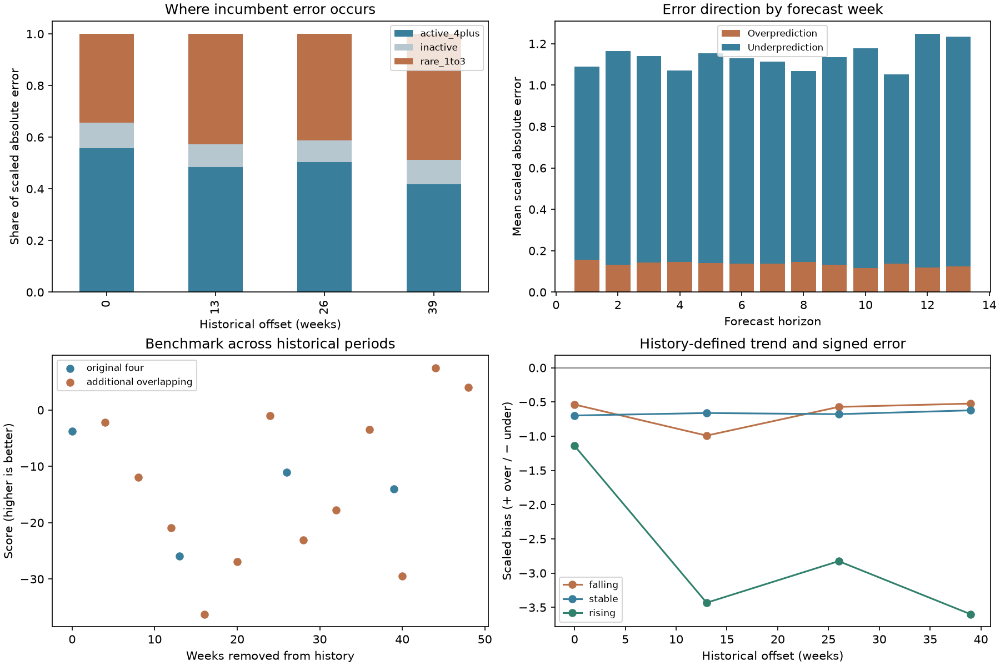

# Phase 1 completed — 2026-11-21

Phase 1 diagnosed the **winning ensemble**, inventoried additional saved
forecasts, fixed the next experiment's evaluation contract, and prioritized one
hypothesis. No replacement model was trained, no blend weights were changed,
and no submission was generated or uploaded.

Consulted the Senior Data Scientist skill and `references/ds-workflows.md`.
Its generic regression scorer was not substituted for the project's MASE.

## Benchmark verification

The original four scores reproduce as -3.7249, -25.9074, -11.0106, -14.0208,
equal-period mean **-13.6659**. The original submission checksum remains
`af2d49198248e54f4fe5b175484f019fb9c4b22ec1f0b6f916d344f01bfb5639`.

Primary predictions come from immutable commit `71b82f3`; working files were not
merged or replaced. Every diagnostic cut was independently checked against
`validate.score`, including scored-series counts. Scaled absolute error equals
over-error plus under-error, and mutually exclusive groups within each dimension
sum to 100% of scored error. Different dimensions overlap and must not be added.

## Findings on the ensemble, not just LightGBM

Each percentage below is an equal-period mean across the original four cuts,
unless stated otherwise. Series with zero/undefined scale are excluded under
the existing convention and reported in [scores.csv](results/scores.csv).

| History-defined group | Share of scored products | Share of scaled error | Interpretation |
|---|---:|---:|---|
| First observed sale within 13 weeks | **3.1%** | **33.0%** | Highest priority for targeted investigation |
| First observed sale 14–26 weeks ago | 3.4% | 9.9% | Early sales history remains difficult |
| Sales in 1–3 of previous 13 weeks | 21.3% | 41.8% | Rare but recently active products are costly |
| No sales in previous 13 weeks | 28.0% | 9.1% | Blanket inactive-product tuning is lower priority |
| Rising recent level | 9.3% | 29.8% | Recent level changes are difficult |
| High base-model disagreement | 2.5% | 25.9% | Useful diagnostic signal; routing is not yet validated |
| Stock missing in >25% of previous 13 weeks | 1.6% | 20.2% | May mark early/poorly observed histories; not a causal stock finding |

"First observed sale" is a historical event, **not proof of a product launch**.
History groups use only pre-cut sales/stock or available model predictions.
Stock findings are observational and groups may overlap strongly with activation.

The recent-activation group accounts for **26.4–37.9%** of error across the four
primary cuts. It also contributes **34.6%** on average in the 12 additional
overlapping origins, ranging 22.3–48.6%, with a 3.4% mean product share. This is a
recurring descriptive pattern, not an independent replication or proof of an
available forecasting gain. Small full-history scales magnify these errors.

The worst approximately 10% of products per cut account for **59.0–63.6%** of
scaled error; the worst approximately 1% account for 25.2–32.8%. These product
rankings are post-outcome diagnostics. Do not turn their identities into rules.

Underprediction contributes **84.4–89.7%** of scaled absolute error in the four
primary periods. All broad groups have negative mean signed error. This does
**not** justify globally raising forecasts: absolute-error objectives seek the
conditional median, and sparse sales naturally create this asymmetry. Any upward
adjustment must earn a net MAE/MASE improvement on matched validation periods.

Weeks 8–13 have higher mean scaled error than weeks 1–7 in 3/4 primary periods.
Their equal-period scores remain **-15.2673** versus **-12.2933**. The peak/event
period reverses the pattern, so no universal horizon multiplier is established.

Evidence: [group_summary.csv](results/group_summary.csv),
[per-period groups](results/groups.csv), [horizons.csv](results/horizons.csv), and
[error concentration](results/error_concentration.csv). Detailed product rows
remain local/regenerable under ignored `results/details/`.



## Additional history recovered and provenance limitation

`git fetch origin` found source commit
`5592b3593c794dd21b441b0fdd564eea90f78248`. It contains all three foundation
components and LightGBM for 13 overlapping offsets 0,4,...,48. There are **16
unique evaluable origins** combining this batch with the original four; offset
0 uses the original source and is not counted twice.

Inventory: [forecast_inventory.csv](results/forecast_inventory.csv). The batch
also contains donor meta-ensemble results, so it is already used development
evidence. No remote GPU process was assumed live or accessed.

The duplicated offset-0 Moirai, TiRex and LightGBM forecasts match the originals.
**Chronos-T5-small differs**: mean absolute difference 1.5016 units per forecast
cell, maximum 194.1690. The composed rounded recipe differs by 0.3443 units per
cell on average (maximum 46). This audit does not establish the cause; the
forecast-generation metadata does not provide a seed to resolve it.

Original benchmarks stay pinned. Additional comparisons must use matching
component files on both sides; otherwise generation differences could be mistaken
for a model improvement. Checks: [duplicate_origin_checks.csv](results/duplicate_origin_checks.csv).
The new LightGBM arrays follow the donor runner's documented sorted-key contract;
only the original cuts and duplicated origin have independent value cross-checks.

## Fixed validation contract

Authoritative readable contract: [VALIDATION.md](../../VALIDATION.md).
Machine-readable version: [validation.json](validation.json).

- Original four periods remain the primary equal-period development score.
- Additional nonoverlapping forward-check targets are offsets 0,16,32. For any
  learned calibration/meta-model, label windows must satisfy `train_offset >=
  test_offset + 13`. The checker verifies 15 eligible pairs and disjoint targets.
- These periods are **not untouched**; no independent forward confirmation exists.
- Offset 65 (2021-10-25 to 2022-01-17) is reserved unscored for a post-freeze older
  regime stress check. Its four component forecasts are missing. It is feasible
  from 65 historical weeks, but is a backward stress test rather than future
  confirmation after later-period development.
- No candidate promotion from score changes on overlapping windows alone.
  Review target: at least +0.5 average points, wins in at least 3/4 primary periods,
  no mean deterioration on weeks 8–13, and consistent additional forward checks.

Fold evidence: [purged_forward_folds.csv](results/purged_forward_folds.csv).
No A-D or unseen-shop performance claim is made from these target-shop forecasts.

## One prioritized hypothesis for phase 2

**Activation-aware history features may improve the LightGBM component for
products with a short observed sales history, without changing the ensemble.**

Reason: 3.1% of scored products with first sales in the previous 13 weeks create
33.0% of benchmark error, recurring across periods. Current rolling windows
include pre-first-sale zeros; `series_age` already exists, so simply adding age
again is not a new experiment. Explicit within-activation sale frequency and
positive-sale size could make the relevant interactions easier to learn.

Proposed first ablation, **not implemented in phase 1**:

1. Add positive-sale frequency over the last `min(13, observed_age)` weeks,
   distinguishing a newly active series from an older, rarely selling one.
2. Add the median of strictly positive sales in the previous 13 weeks, scaled
   using the same origin-specific history scale; missing when unavailable.

Train the otherwise unchanged LightGBM recipe, loss, inner purge and settings.
Keep all three foundation forecasts, the 70/30 weights, zero rule and rounding
fixed. These are features to learn from, **not** a forced nonzero prediction or
replacement of the MASE denominator. No hand-selected product IDs, global uplift,
or simultaneous residual-target change. Stop if it fails the fixed evaluation
criteria. Residual learning and product-dependent weights stay later alternatives.

This hypothesis is grounded in error concentration, not proof that the remaining
error is predictable. Phase 2 requires the user's next-stage direction.

## Reproduction and verification

```bash
git fetch origin
.venv/bin/python iterations/10-benchmark-diagnosis/diagnose.py
.venv/bin/python iterations/10-benchmark-diagnosis/check_protocol.py
.venv/bin/python tests/test_benchmark_diagnosis.py
```

The diagnosis refuses to overwrite its output directory; use a fresh `--output`
for reruns. The protocol checker uses canonical `results/`. Python/package
versions, all prediction hashes, target input and incumbent hashes, and script
fingerprint are in [metadata.json](results/metadata.json).

Verification: 16 canonical metric parity checks, per-dimension conservation,
over/under decomposition checks, unchanged input/incumbent hashes, 3 boundary/
history-prefix/purge tests, and inspected plot. The additional array row-order
limitation is disclosed above. Existing timedelta and font-cache warnings were
nonfatal. No core preprocessing, feature or scorer implementation was changed.

Phase 1 is complete as a diagnostic/validation deliverable; fresh-confirmation
data and candidate accuracy improvement remain unproven. Nothing committed,
pushed, or submitted.
